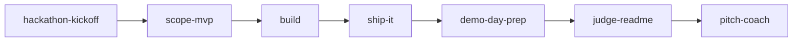

# HackNitra tools and skills

[](https://github.com/HackNitra/tools-and-skills/actions/workflows/validate.yml)
[](LICENSE)

A toolkit for building a hackathon project fast with [Claude Code](https://docs.claude.com/en/docs/claude-code/overview): skills, slash commands, subagents and a safety hook, packaged as one plugin. Made for HackNitra attendees; use it at any hackathon.

## Quick start

```
/plugin marketplace add HackNitra/tools-and-skills
/plugin install hacknitra-toolkit@hacknitra
```

Then type `/hackathon-kickoff`. Full walkthrough: [docs/getting-started.md](docs/getting-started.md).

## What is inside

### Skills (`skills/`)

| Skill | Use it when |
|---|---|
| `hackathon-kickoff` | You have a team and a theme and need a plan, now |
| `scope-mvp` | The idea is too big for the time left |
| `claude-code-primer` | You are new to Claude Code |
| `debug-fast` | Something is broken and the clock is ticking |
| `ship-it` | You need a public URL |
| `demo-day-prep` | The last 2-3 hours: freeze, verify, package |
| `judge-readme` | You need a README judges understand in 60 seconds |
| `pitch-coach` | You need a 3-minute pitch, demo script and judge Q&A |
| `repo-init` | You want a TypeScript monorepo (Turborepo, Next.js, Kysely, CI) |
| `feature-spec` | A big feature needs an interview-driven spec |

### Slash commands (`commands/`)
`/standup`, `/cut-scope <hours>`, `/prep-demo`, `/write-readme`, `/explain-codebase`

### Subagents (`agents/`)
`code-reviewer` (read-only, demo-breaking bugs first), `demo-tester` (walks the flow like a judge), `pitch-critic` (tough but fair judge)

### Hook (`hooks/`)
`secret-guard` blocks `git commit` and `git push` when staged changes contain API keys, tokens, private keys or database URLs with passwords.

### Templates (`templates/`)
Starter `CLAUDE.md` and `PLAN.md` for your project.

## The workflow



Details per phase: [docs/workflow.md](docs/workflow.md).

## Third-party skills I use (links, not copies)

- Neon skills (`neon`, `neon-auth`, `neon-postgres`, `neon-functions`, `neon-realtime`, `neon-object-storage`, `neon-ai-gateway`, `neon-postgres-branches`, `neon-postgres-egress-optimizer`) via the `neon-postgres@neon` plugin
- `building-components`, `find-skills`, `turborepo`, `web-design-guidelines` via `npx skills add` / the skills.sh registry

## MCP servers and plugins
See [`mcps/`](mcps/README.md) and [`plugins/`](plugins/README.md).

Running a Discord server for your event? See [hacknitra_discord_manager](https://github.com/HackNitra/hacknitra_discord_manager).

## Contributing

PRs welcome, small and tested. See [CONTRIBUTING.md](CONTRIBUTING.md). Run `node scripts/validate.mjs` before opening one.

## License
[MIT](LICENSE)
