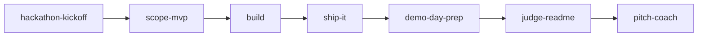

# HackNitra: nástroje a skilly

[](https://github.com/HackNitra/tools-and-skills/actions/workflows/validate.yml)
[](LICENSE)

Sada nástrojov na rýchle budovanie hackathonového projektu s [Claude Code](https://docs.claude.com/en/docs/claude-code/overview): skilly, slash príkazy, subagenti a bezpečnostný hook v jednom plugine. Pripravil tím HackNitra pre účastníkov, použiť ju môžeš na akomkoľvek hackathone.

## Rýchly štart

```
/plugin marketplace add HackNitra/tools-and-skills
/plugin install hacknitra-toolkit@hacknitra
```

Potom napíš `/hackathon-kickoff`. Celý postup: [docs/getting-started.md](docs/getting-started.md).

## Čo je vnútri

### Skilly (`skills/`)

| Skill | Kedy ho použiť |
|---|---|
| `hackathon-kickoff` | Máš tím a tému a potrebuješ plán hneď |
| `scope-mvp` | Nápad je väčší, než stihneš |
| `claude-code-primer` | Si v Claude Code nový |
| `debug-fast` | Niečo nefunguje a čas beží |
| `ship-it` | Potrebuješ verejnú URL |
| `demo-day-prep` | Posledné 2-3 hodiny: zmrazenie funkcií, overenie, odovzdanie |
| `judge-readme` | Potrebuješ README, ktoré porotcovia pochopia za 60 sekúnd |
| `pitch-coach` | Potrebuješ 3-minútový pitch, demo scenár a otázky poroty |
| `repo-init` | Chceš TypeScript monorepo (Turborepo, Next.js, Kysely, CI) |
| `feature-spec` | Veľká funkcia potrebuje špecifikáciu cez rozhovor |

### Slash príkazy (`commands/`)
`/standup`, `/cut-scope <hodiny>`, `/prep-demo`, `/write-readme`, `/explain-codebase`

### Subagenti (`agents/`)
`code-reviewer` (iba na čítanie, najprv chyby, ktoré zničia demo), `demo-tester` (prejde demo ako porotca), `pitch-critic` (prísna, ale férová porota)

### Hook (`hooks/`)
`secret-guard` zablokuje `git commit` a `git push`, ak staged zmeny obsahujú API kľúče, tokeny, privátne kľúče alebo databázové URL s heslom.

### Šablóny (`templates/`)
Štartovacie `CLAUDE.md` a `PLAN.md` pre tvoj projekt.

## Postup práce



Detaily po fázach: [docs/workflow.md](docs/workflow.md).

## Skilly a nástroje, ktoré odporúča tím HackNitra

Tieto sú od iných autorov, preto ssú len odkazy, nie kópie.

- Neon skilly (`neon`, `neon-auth`, `neon-postgres`, `neon-functions`, `neon-realtime`, `neon-object-storage`, `neon-ai-gateway`, `neon-postgres-branches`, `neon-postgres-egress-optimizer`) cez plugin `neon-postgres@neon`
- `building-components`, `find-skills`, `turborepo`, `web-design-guidelines` cez `npx skills add` alebo register skills.sh

## MCP servery a pluginy
Pozri [`mcps/`](mcps/README.md) a [`plugins/`](plugins/README.md), oboje odporúčané tímom HackNitra.

Spravuješ Discord server pre svoj event? Pozri [hacknitra_discord_manager](https://github.com/HackNitra/hacknitra_discord_manager).

## Prispievanie

PR sú vítané, malé a vyskúšané. Pozri [CONTRIBUTING.md](CONTRIBUTING.md) a pred otvorením PR spusti `node scripts/validate.mjs`.

## Licencia
[MIT](LICENSE)
