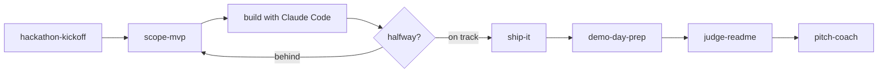

# The hackathon workflow

| Phase | Skill or command | Agent |
|---|---|---|
| Plan | `hackathon-kickoff`, `feature-spec` | |
| Set up | `repo-init`, `claude-code-primer` | |
| Build | `/standup`, `debug-fast` | `code-reviewer` |
| Cut | `scope-mvp`, `/cut-scope` | |
| Deploy | `ship-it`, `neon-*` | |
| Finish | `demo-day-prep`, `judge-readme` | `demo-tester` |
| Pitch | `pitch-coach` | `pitch-critic` |

Templates for `CLAUDE.md` and `PLAN.md` are in [`templates/`](../templates).
