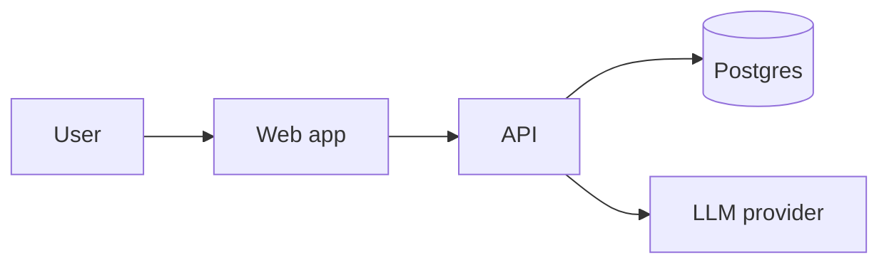

# Judge-Ready README

Judges skim. Optimize for a 60-second read, then depth below the fold.

## Read the repo first

Inspect the code, package files, existing docs and git log so every claim is true. Never describe a feature that does not exist; mark mocked parts honestly.

## Structure

1. **Name + one-line pitch**, then badges only if they are real.
2. **Demo**: live URL and video link first, a GIF or screenshot right below.
3. **Problem and solution**: 3-5 sentences, a concrete user.
4. **Features**: bullets of what works today. A "mocked / not yet" list is a plus.
5. **How it works**: one architecture diagram (Mermaid renders on GitHub) and the stack, naming sponsor tech used.
6. **Run it locally**: prerequisites, copy-paste commands, `.env.example` explained. Test them.
7. **Team**: names and roles, with links.
8. **What is next** and **what we learned**.
9. **License**.

## Mermaid starter

Keep it under ~150 lines. Put detail in `docs/`. Offer to capture screenshots into `docs/`.
